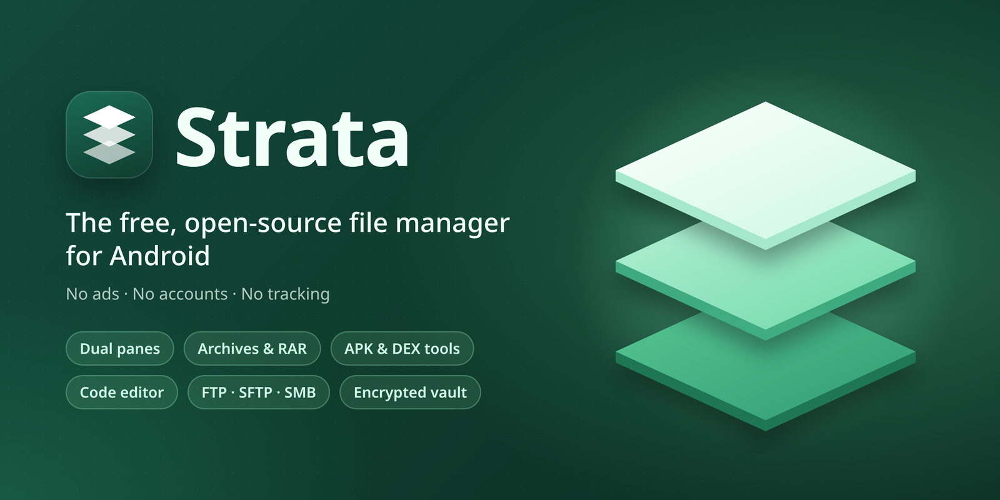

<p align="center">
  
</p>

<p align="center">
  <a href="https://github.com/CluvexStudio/Strata/actions/workflows/build.yml"></a>
  <a href="LICENSE"></a>
</p>

**Strata** is a free, open-source file manager for Android with the tools power users need: two panes, archives, APK and DEX editing, a code editor, network storages and an encrypted vault. No ads, no accounts, no tracking.

## Features

- **Files**: two panes side by side, drag and drop onto folders, root and Shizuku access, recycle bin, search by name or content, batch rename, bookmarks, permissions, links, split and merge, file encryption
- **Archives**: open and extract ZIP, 7z, RAR, TAR, GZ, XZ, ZST and more; create ZIP, 7z and TAR archives with passwords
- **APK tools**: app details, split APK install, signing (v1 to v3) and signing keys, clone with a new name and icon, DEX and smali editor, Java decompiler, manifest and resource editors
- **Editors and viewers**: code editor with syntax highlighting, hex editor, PDF reader, image viewer, music and video player, font viewer, Markdown preview, 9-patch editor, color picker
- **Network**: FTP, SFTP, SMB and WebDAV right in the panes, plus Wi-Fi sharing with an FTP server or a file manager in the browser
- **Code runner**: run and build code in many languages through Termux
- **Privacy**: an encrypted vault opened with your fingerprint, app lock, and nothing that leaves your phone unless you send it
- **Languages**: English, Persian (fully right-to-left), Russian and Chinese
- **Design**: Material 3 Expressive with dynamic colors, light and dark themes

## Building

You need the Android SDK with an NDK, and Rust with the Android targets and `cargo-ndk`. JDK 17 is set up by Gradle.

```bash
rustup target add aarch64-linux-android armv7-linux-androideabi x86_64-linux-android
cargo install cargo-ndk
native/fetch-pdfium.sh
native/build.sh
./gradlew :app:assembleDebug
```

## Support the developer

Strata is free and open source. If it saves you time and you'd like to help it grow, you can send a donation to one of these addresses. Every bit of support is appreciated. Thank you!

| Coin and network | Address |
|---|---|
| TRX / USDT · Tron (TRC-20) | `TRxVSHcoADZnBfztFmFb2TQopusAwWYEVR` |
| USDT · BNB Smart Chain (BEP-20) | `0x20c980AEF36Aa71D0A0e7bE382AeD20b73bC6D27` |
| TON (Gram) | `UQAH75bXaaRUhZMwiF0ZujOXFDDmvLSPASKoOsWF0HNasiaM` |

Send each coin only on the network named next to its address. The same addresses are in the app under **Settings → Support the developer**.

## License

Strata is licensed under the [GNU AGPL v3.0 or later](LICENSE). Third-party components keep their own licenses; they are listed in the app under **Settings → About**.
